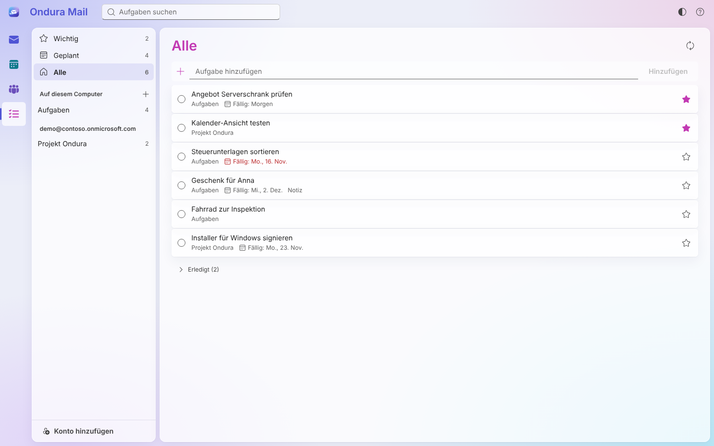
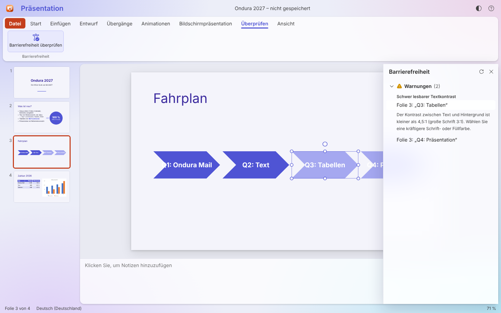
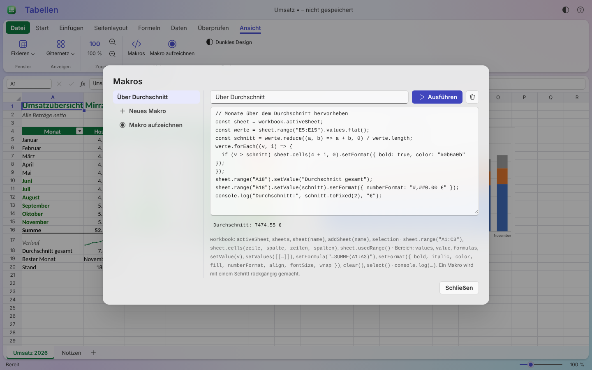

# Ondura

An office suite for **Windows and Linux**, written in **Rust**, with a user interface modelled on Microsoft 365.


| Kalender | Kontakte | Aufgaben |
| --- | --- | --- |
|  |  |  |

| App | Status |
| --- | --- |
| **Ondura Mail**: e-mail, calendar, contacts and tasks in one window (like Outlook) | 🚧 first version |
| ├ E-Mail: Microsoft 365 / Exchange Online, Exchange Server and IMAP; S/MIME signing and encryption, automatic replies, shared mailboxes | |
| ├ Kalender: day, work week, week, month, recurring events, reminders, scheduling assistant and room finder | |
| ├ Kontakte: address books, vCard import, address completion when writing mail | |
| └ Aufgaben: task lists in the style of Microsoft To Do | |
| **Ondura Text**: word processor with a Word-like page view, styles, comments, tracked changes, footnotes/endnotes, captions, citations and bibliography, sections and table of contents, mail merge, content controls, macros, `.docx` and `.odt` | 🚧 first version |
| **Ondura Tabellen**: spreadsheets with ~180 functions, dynamic arrays, Excel tables, charts, pivot tables (grouping, filters), sparklines, what-if analysis and solver, data validation, conditional formatting, macros (with recorder), `.xlsx` and `.ods` | 🚧 first version |
| **Ondura Präsentation**: slides with slide master, tables, charts, editable SmartArt, audio/video, animations, motion paths, transitions incl. Morph, slide zoom and links, pen and laser pointer, rehearsed timings and recorded narration, video export, presenter view, `.pptx` and `.odp` | 🚧 first version |

| Text | Tabellen | Präsentation |
| --- | --- | --- |
|  |  |  |

All three office apps have an accessibility checker (*Überprüfen › Barrierefreiheit überprüfen*): missing alternative texts and slide titles, tables without header rows, merged cells, skipped heading levels and text with too little contrast (WCAG 2.1), each with an explanation and, where possible, a one-click fix.

| Signed mail and automatic replies | Accessibility checker | Macros |
| --- | --- | --- |
|  |  |  |

The office apps read and write the Microsoft Office formats and the OpenDocument formats of LibreOffice directly (no conversion step) and export PDF files (*Datei › Als PDF exportieren*). What a file contains beyond the apps' model is listed under *Datei › Informationen* when the file is opened; a save in the OpenDocument format says what it could not keep. SmartArt from PowerPoint opens as an editable graphic (items, levels and layout come from its data model); Ondura saves SmartArt as a group of shapes that other apps show and Ondura can edit again.

| Dark mode | Ondura Setup (Windows) |
| --- | --- |
|  |  |

## Architecture

```
Ondura/
├── crates/
│   ├── mail-core/    # domain model, SQLite store, provider trait, sync engine
│   ├── mail-imap/    # IMAP (async-imap) + SMTP (lettre) adapter, IMAP IDLE
│   ├── mail-graph/   # Microsoft Graph adapter (Microsoft 365 / Exchange Online)
│   ├── mail-ews/     # Exchange Web Services adapter (Exchange Server on-premises, NTLM)
│   │                 #   mail-graph and mail-ews also implement calendars/contacts (pim.rs)
│   ├── pim-core/     # calendars, contacts, tasks: model, SQLite store, iCalendar/vCard,
│   │                 #   recurrence expansion, sync engine, reminders
│   ├── pim-dav/      # CalDAV + CardDAV adapter (Nextcloud, Radicale, mailbox.org, iCloud, …)
│   ├── smime/        # S/MIME in pure Rust: X.509, PKCS#12, CMS signing and encryption
│   └── office/       # Office Open XML and OpenDocument reader and writer
└── apps/
    └── ondura/       # the desktop suite (Tauri 2)
        ├── src/          # UI: React + Fluent UI 9 (Microsoft's own design system)
        │   └── apps/     #   mailwindow, mail, calendar, contacts, tasks, text, sheets, slides
        └── src-tauri/    # Rust host: commands, windows, OS keychain, installer config
```

* **Local first.** The UI reads only from the local SQLite store. The `SyncEngine` mirrors server state into that store.
* **Action queue.** User actions (read, flag, move, delete, send, save draft) change the store immediately and are queued in `pending_ops`. A background flusher sends them to the server in order. While the server is unreachable, it keeps them and retries with backoff (15 s up to 15 min), so the UI never waits for the network and nothing is lost offline. A sync that runs before a queued change has reached the server does not undo it locally. If the server refuses a message, it stays in the **outbox**, where it can be retried, edited or discarded.
* **Push.** IMAP accounts keep an IDLE connection on the inbox, so new mail shows up within seconds. Graph and EWS accounts poll the inbox every minute. All folders are synced every few minutes (configurable). New mail triggers a desktop notification.
* **Separate connections.** IMAP uses one connection for background sync, one for user actions and one for IDLE, so opening a message never waits behind a long sync. Every operation has a timeout, and broken connections are re-established automatically.
* **Protocols are adapters.** Each adapter implements `MailProvider` (`crates/mail-core/src/provider.rs`). A new protocol does not need changes to the UI or the store.
* **One binary, many apps.** The whole suite is a single executable. `ondura --app mail` opens Ondura Mail (`--app calendar`, `contacts` or `tasks` open Ondura Mail on that module), and running it without arguments opens the start page. A second launch hands its arguments to the running instance (single instance), so every app runs as a window of the same process and they all share accounts, store and sync.
* **Modules, not apps.** Calendar, contacts and tasks are modules of the Ondura Mail window, switched from the app rail on the left like in Outlook. A module is mounted on first use and then kept alive, so switching is instant and keeps its state.
* **Own title bar.** Windows have no native decorations; the header is the title bar (drag area, double-click to maximise, Windows 11 style window buttons) so it matches the Fluent design on Windows and Linux.
* **One installer for the whole suite, installed system-wide.** The NSIS installer (Windows, Program Files, administrator rights required) and the `.deb`/`.rpm` packages (Linux) install the suite once and add a Start menu entry or `.desktop` file for each app (`src-tauri/windows/installer-hooks.nsh`, `src-tauri/linux/`).
* **Choose the apps (Windows).** Ondura Mail can be installed on its own; the office apps (Text, Tabellen, Präsentation) are only installed together. The NSIS installer has a page for this (`src-tauri/windows/installer.nsi`, the tauri-cli template with that page added), silent installs take `/MAILONLY` or `/OFFICEONLY`. The choice is remembered and written to `components.ini` next to `ondura.exe`; the start page, `--app` and file associations only offer what is installed.
* **Ondura Setup (Windows).** Besides the plain NSIS installer, the build produces `Ondura_<version>_x64_Setup.exe` (`apps/setup`): an Office-style installer in the suite's design that embeds the NSIS installer. It lets the user pick the apps, starts the embedded installer with administrator rights (UAC prompt) while the setup itself and the app opened at the end run as the signed-in user, detects an installed version and offers an update (accounts and data stay), shows real progress and replaces an earlier per-user installation.
* **Secrets** such as passwords and OAuth refresh tokens are stored in the OS credential store: Windows Credential Manager, or Secret Service (GNOME Keyring / KWallet) on Linux. They are never written to the database. On systems without a credential store, they fall back to a file that only the user can read (`secrets.json` in the data folder), and the settings show a warning.
* **Search.** An SQLite FTS5 index covers subject, sender and message text (prefix matching, umlauts folded).
* **Background mode.** Closing the last window keeps Ondura running in the tray (configurable), so mail and notifications keep arriving.
* **Calendars, contacts and tasks** use the same local-first design (`crates/pim-core`). `PimEngine` mirrors every collection into `pim.sqlite`, syncs every 5 minutes and on demand, and fires reminder notifications. Recurring events are stored as series (RRULE, EXDATE, overrides) and expanded for the visible window, so editing "only this occurrence" or "the whole series" works the same for every backend. Calendars on this computer work without any account.
* **Design.** Familiar Outlook layout with its own look: the "Ondura Indigo" brand colour, a soft colour backdrop and translucent glass surfaces in the spirit of Apple's materials; menus, popovers and dialogs blur what lies beneath (`src/shell/theme.tsx`, `src/styles.css`).
* **Privacy.** HTML mail is shown in a sandboxed iframe with a strict CSP: scripts never run, and remote images (tracking pixels) are blocked until the user allows them.
* **S/MIME.** Own certificates are imported from `.p12`/`.pfx` (*Einstellungen › S/MIME*); the private key goes to the OS credential store. Messages can be signed and encrypted for all three account types (IMAP sends the MIME over SMTP, Exchange via `CreateItem`, Microsoft 365 via MIME `sendMail`). Received signatures are checked, including the issuer chain against the Mozilla root store; the reading pane shows whether a signature is valid, trusted and from the sender. Certificates of people who sent a signed message are remembered, so replies can be encrypted. Encrypted messages stay encrypted in the local store and are opened only for display. The crypto (`crates/smime`) is pure Rust and tested both ways against OpenSSL.
* **Automatic replies** are stored on the server, so they work while Ondura is closed: `mailboxSettings` (Microsoft 365), `Get/SetUserOofSettings` (Exchange) or a Sieve `vacation` script uploaded via ManageSieve (IMAP servers such as Dovecot). An already active Sieve script keeps working: Ondura's script includes it and hands control back when the reply is switched off.
* **Shared mailboxes** (*Ansicht › Freigegebenes Postfach*) open with the rights of a Microsoft 365 or Exchange account and appear as their own account with mail, calendar and contacts.
* **Macros** are JavaScript scripts with a small object model (like Excel's Office Scripts) in Tabellen and Text. They are kept in the local profile, never in documents, so opening a file can't run code; VBA macros in `.xlsm`/`.docm` files are not run.

### Exchange support

Microsoft is switching off EWS in Exchange Online: it is being disabled step by step from 1 October 2026 and will be removed completely on 1 April 2027. Ondura Mail therefore uses:

| Server | Protocol | Status |
| --- | --- | --- |
| Microsoft 365 / Exchange Online / Outlook.com | **Microsoft Graph** (delta sync, OAuth 2.0 + PKCE) | ✅ |
| Exchange Server 2013 SP1+ (on-premises) | **EWS** (`SyncFolderItems`, MIME bodies), NTLMv2 or Basic | ✅ |
| Any other mail server | **IMAP + SMTP** (TLS / STARTTLS), automatic replies via **ManageSieve** | ✅ |

Calendars, contacts and tasks:

| Server | Calendar | Contacts | Tasks |
| --- | --- | --- | --- |
| Microsoft 365 (Graph) | ✅ `calendarView`, series, free/busy, rooms | ✅ | ✅ Microsoft To Do |
| Exchange Server (EWS) | ✅ `CalendarView`, series, free/busy, rooms | ✅ | – |
| CalDAV / CardDAV (Nextcloud, Radicale, …) | ✅ | ✅ | ✅ (`VTODO`) |
| On this computer | ✅ | ✅ | ✅ |

Microsoft 365 and Exchange accounts added in Ondura Mail show their calendars and contacts automatically. CalDAV/CardDAV servers are added as their own account ("Konto hinzufügen" → *CalDAV / CardDAV*); the server address is enough, calendars and address books are discovered automatically (`.well-known`, principal, home sets).

## Microsoft 365 setup (one-time)

Graph needs an app registration in Microsoft Entra ID:

1. Go to <https://entra.microsoft.com> → *App registrations* → *New registration*.
2. Name: `Ondura`. Supported account types: *Accounts in any organizational directory and personal Microsoft accounts*.
3. Redirect URI: platform **Public client/native (mobile & desktop)**, URI `http://localhost`. Any port is allowed for loopback.
4. Under *Authentication*, set **Allow public client flows** to *Yes*.
5. Under *API permissions*, add these delegated Microsoft Graph permissions: `offline_access`, `User.Read`, `Mail.ReadWrite`, `Mail.Send`, `Calendars.ReadWrite`, `Contacts.ReadWrite`, `Tasks.ReadWrite`, `Files.ReadWrite` (only used to share attachments over 150 MB via OneDrive), `MailboxSettings.ReadWrite` (automatic replies) and `Mail.ReadWrite.Shared`, `Mail.Send.Shared`, `Calendars.ReadWrite.Shared`, `Contacts.ReadWrite.Shared` (shared mailboxes). Optional: `Place.Read.All` for the room finder; it needs admin consent and is never asked for at sign-in. Accounts signed in before a permission was added are asked to sign in again when they first use the feature.
6. Copy the *Application (client) ID*. Either enter it in the "add account" dialog, or bake it into the build (then the field is hidden under *Erweiterte Einstellungen*). For Outlook.com/Hotmail accounts, tick *Privates Microsoft-Konto* in the dialog; it signs in through the `consumers` endpoint instead of `common`.
   Personal Microsoft accounts cannot register apps on their own; create a free Entra directory first (e.g. via the Azure free account).
   ```sh
   ONDURA_GRAPH_CLIENT_ID=<client-id> npx tauri build
   ```
   In GitHub Actions, set the repository variable `ONDURA_GRAPH_CLIENT_ID`.

## Building

Requirements: Rust ≥ 1.90 and Node.js ≥ 20.

**Linux (Debian/Ubuntu):**
```sh
sudo apt install libwebkit2gtk-4.1-dev libgtk-3-dev libayatana-appindicator3-dev librsvg2-dev build-essential
```
**Windows:** Visual Studio Build Tools (C++ workload). WebView2 is part of Windows 10/11.

```sh
cd apps/ondura
npm ci
npx tauri dev                       # development, with hot reload
npx tauri build                     # installers in target/release/bundle/
npx tauri build --bundles deb       # only the .deb package
```

`npm run dev` on its own starts the UI in the browser with **demo data**, which is handy for UI work without a mail account.

### Jenkins

The `Jenkinsfile` builds everything on a **Linux agent**: tests, `.deb`/`.rpm`/`.AppImage`, and the **Windows installer** (NSIS), which is cross-compiled with [cargo-xwin](https://github.com/rust-cross/cargo-xwin). Artifacts are archived on the job.

One-time agent setup (Debian/Ubuntu):

```sh
sudo apt install libwebkit2gtk-4.1-dev libgtk-3-dev libayatana-appindicator3-dev librsvg2-dev \
                 build-essential file nsis lld llvm clang
curl https://sh.rustup.rs -sSf | sh -s -- -y        # as the jenkins user
rustup target add x86_64-pc-windows-msvc
cargo install --locked cargo-xwin
# plus Node.js >= 20 (e.g. NodeSource packages)
```

Job parameters: `BUILD_WINDOWS` (default on) and `GRAPH_CLIENT_ID` (optional Entra client id baked into the build). On its first run, cargo-xwin downloads the Windows SDK/CRT headers from Microsoft and caches them in `~/.cache/cargo-xwin`.

### GitHub Actions

Every push builds the Windows installer (`.exe`, NSIS) and the Linux packages (`.deb`, `.rpm`, `.AppImage`) with GitHub Actions (`.github/workflows/build.yml`).

## Releases and updates

Ondura checks the [GitHub releases](https://github.com/LinzN/Nexora/releases) of this repository (at start, at most every 12 hours, and via *Hilfe › Nach Updates suchen*). An available update shows an *Update* button in the title bar; it downloads the installer for the running system, verifies its signature and installs it:

* Windows: the NSIS installer runs elevated (UAC prompt), passive, keeps the chosen apps (Ondura Mail/Office) and restarts Ondura.
* Linux: AppImages replace themselves; `.deb`/`.rpm` installs use `pkexec dpkg -i` / `pkexec rpm -U`.

Updates are only installed when the minisign signature (`<file>.sig`) matches the public key compiled into the app, so a tampered download is never run. One-time setup:

1. `cd apps/ondura && npx tauri signer generate -w ~/.ondura/update.key` (keep the key and its password safe – without it no further updates can be published).
2. Repository secret `TAURI_SIGNING_PRIVATE_KEY` = content of `update.key` (and `TAURI_SIGNING_PRIVATE_KEY_PASSWORD` if you set one).
3. Repository variable `ONDURA_UPDATE_PUBKEY` = content of `update.key.pub`.

Publishing a release: `scripts/release.sh 0.2.0` sets the version in all manifests, commits and tags; `git push origin main v0.2.0` lets CI build, sign and publish the release. Builds without the public key still announce updates but only link to the release page.

## Tests

```sh
cargo test --workspace
cargo clippy --workspace --all-targets
```

The office formats are tested with fixtures created by python-docx, openpyxl and python-pptx (`crates/office/tests`), including round trips (read → write → read).

S/MIME is tested against fixtures made with OpenSSL 3 (`crates/smime/tests/fixtures`): PKCS#12 files in the OpenSSL 3, Windows (3DES) and legacy (RC2) formats, detached and opaque signatures, AES, 3DES and RSA-OAEP encryption. Messages signed and encrypted by Ondura were verified and decrypted with `openssl smime`.

Automatic replies via ManageSieve have a test against a real server (e.g. Dovecot with Pigeonhole and `managesieve` on port 4190):

```sh
ONDURA_SIEVE_TEST=127.0.0.1:niklas:geheim cargo test -p ondura-mail-imap live_server
```

The Graph and EWS adapters are tested against mock servers (`crates/mail-graph/tests`, `crates/mail-ews/tests`); the EWS test includes the NTLM handshake, whose crypto is checked against the MS-NLMP test vectors.

The IMAP adapter has an integration test that runs against a real server (for example a local Dovecot) and covers sync, IDLE, flags, the action queue, move/delete, drafts and loading older messages:

```sh
ONDURA_IMAP_TEST_PORT=10993 ONDURA_IMAP_TEST_USER=test@localhost ONDURA_IMAP_TEST_PASS=secret \
ONDURA_IMAP_TEST_CA=/path/to/ca.pem cargo test -p ondura-mail-imap --test dovecot -- --ignored --test-threads=1
```

The CalDAV/CardDAV adapter has an integration test against a real server, for example [Radicale](https://radicale.org) with a user `niklas`/`geheim`, a calendar `privat` (events and tasks) and an address book `kontakte`:

```sh
ONDURA_DAV_URL=http://127.0.0.1:5232/niklas/ ONDURA_DAV_USER=niklas ONDURA_DAV_PASS=geheim \
cargo test -p ondura-pim-dav --test radicale -- --ignored --test-threads=1
```

## Roadmap (Ondura Mail)

Done:

- [x] IMAP/SMTP, Microsoft Graph and EWS (Exchange Server) accounts
- [x] Action queue with offline support and an outbox
- [x] IMAP IDLE, desktop notifications, tray icon and background mode
- [x] Load older messages from the server, full-text search (FTS5)
- [x] Attachments when composing (incl. forwarding with the original attachments), drafts, signatures
- [x] Inline images (`cid:`) in the reading pane
- [x] Settings (sync interval, notifications, background mode, remote images, accounts)
- [x] Account status in the folder pane, re-login for expired credentials

- [x] Conversation view
- [x] EWS streaming notifications (push instead of polling)
- [x] Server-side search (IMAP, Graph, EWS)
- [x] Trusting self-signed certificates (pinned SHA-256 fingerprint)
- [x] Rules, categories, delayed sending
- [x] S/MIME: sign, encrypt, verify, decrypt; certificate import (.p12/.pfx)
- [x] Automatic replies (Graph, EWS, Sieve/ManageSieve)
- [x] Shared mailboxes (Graph, EWS)

Next:

- [x] Attachments larger than 150 MB for Microsoft 365 (uploaded to OneDrive and shared as a link, like Outlook; needs one new sign-in for accounts added before)
- [ ] Graph change notifications (need a public webhook endpoint; delta sync is used)

## Roadmap (Kalender, Kontakte, Aufgaben)

- [x] Meeting invitations: answer (accept/decline) and send invites from the calendar
- [x] Drag & drop to move and resize events
- [x] Free/busy lookup and scheduling assistant (Graph, EWS)
- [x] Room finder (Graph `places`, EWS room lists)
- [x] Contact groups, photos, vCard export
- [x] Subtasks, recurring tasks, reminders for tasks

## Roadmap (Office apps)

- [x] Text: comments, footnotes, tracked changes, table of contents, different first-page headers
- [x] Tabellen: charts, pictures, conditional formatting, filters, named ranges
- [x] Präsentation: tables and charts on slides, animations and transitions
- [x] Direct PDF export (WebView2 `PrintToPdf` on Windows, WebKitGTK print operation on Linux)
- [x] Installer: system-wide installation, Ondura Mail on its own or together with the office apps
- [x] Text: page and section breaks with different page layouts, endnotes
- [x] Tabellen: pivot tables, data validation, sparklines
- [x] Präsentation: emphasis/exit animations, SmartArt (as shapes), audio and video
- [x] OpenDocument formats (`.odt`, `.ods`, `.odp`)

- [x] OpenDocument: charts, pictures, conditional formatting, validation, filters and sparklines in `.ods`
- [x] Präsentation: motion paths, editable SmartArt
- [x] Tabellen: grouping (years, quarters, months, number ranges) and filters in pivot tables
- [x] Updater: checks GitHub releases, downloads and verifies signed installers
- [x] Tabellen: dynamic arrays, Excel tables, what-if analysis and solver, combo/waterfall/histogram/funnel charts
- [x] Tabellen: notes, hyperlinks, sheet protection, outline, page layout and printing, formula auditing, text to columns, flash fill
- [x] Text: spell checking (German with compound words, English), personal dictionary
- [x] Text: style management, captions/cross-references, citations and bibliography, index, mail merge, content controls
- [x] Präsentation: slide master, Morph, slide zoom, links, connectors, pen/laser pointer, rehearsed timings, recorded narration, video export
- [x] Accessibility checker in Text, Tabellen and Präsentation (alternative texts are saved in all formats)
- [x] Macros (JavaScript) in Tabellen (with recorder) and Text

## Third-party data

The spell checker uses the Hunspell dictionaries from the npm packages `dictionary-de` (igerman98, GPL-2.0 or GPL-3.0) and `dictionary-en` (MIT and BSD). They are shipped as separate files next to the app and loaded at runtime; their licences are in `node_modules/dictionary-*/license`.
