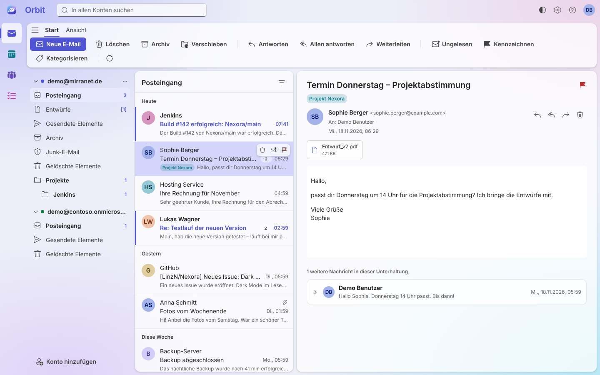
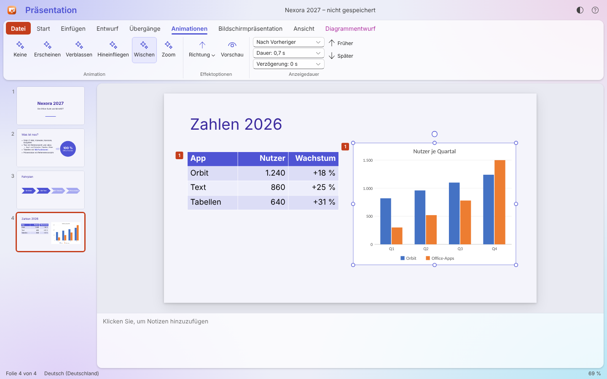

# Nexora

An office suite for **Windows and Linux**, written in **Rust**, with a user interface modelled on Microsoft 365. Formerly *Mirra Office*.



| Kalender | Kontakte | Aufgaben |
| --- | --- | --- |
|  |  |  |

| App | Status |
| --- | --- |
| **Orbit**: e-mail, calendar, contacts and tasks in one window (like Outlook) | 🚧 first version |
| ├ E-Mail: Microsoft 365 / Exchange Online, Exchange Server and IMAP | |
| ├ Kalender: day, work week, week, month, recurring events, reminders | |
| ├ Kontakte: address books, vCard import, address completion when writing mail | |
| └ Aufgaben: task lists in the style of Microsoft To Do | |
| **Nexora Text**: word processor with a Word-like page view, comments, tracked changes, footnotes and table of contents, `.docx` | 🚧 first version |
| **Nexora Tabellen**: spreadsheets with ~180 functions, charts, conditional formatting, filters and named ranges, `.xlsx` | 🚧 first version |
| **Nexora Präsentation**: slides with tables, charts, animations and transitions, slide show and presenter view, `.pptx` | 🚧 first version |

| Text | Tabellen | Präsentation |
| --- | --- | --- |
|  |  |  |

The office apps read and write the Microsoft Office formats directly (no conversion step) and export PDF files (*Datei › Als PDF exportieren*). What a file contains beyond the apps' model (SmartArt, emphasis animations, …) is listed under *Datei › Informationen* when the file is opened.

| Dark mode | Nexora Setup (Windows) |
| --- | --- |
|  |  |

## Architecture

```
Nexora/
├── crates/
│   ├── mail-core/    # domain model, SQLite store, provider trait, sync engine
│   ├── mail-imap/    # IMAP (async-imap) + SMTP (lettre) adapter, IMAP IDLE
│   ├── mail-graph/   # Microsoft Graph adapter (Microsoft 365 / Exchange Online)
│   ├── mail-ews/     # Exchange Web Services adapter (Exchange Server on-premises, NTLM)
│   │                 #   mail-graph and mail-ews also implement calendars/contacts (pim.rs)
│   ├── pim-core/     # calendars, contacts, tasks: model, SQLite store, iCalendar/vCard,
│   │                 #   recurrence expansion, sync engine, reminders
│   ├── pim-dav/      # CalDAV + CardDAV adapter (Nextcloud, Radicale, mailbox.org, iCloud, …)
│   └── office/       # .docx / .xlsx / .pptx reader and writer (Office Open XML)
└── apps/
    └── nexora/       # the desktop suite (Tauri 2)
        ├── src/          # UI: React + Fluent UI 9 (Microsoft's own design system)
        │   └── apps/     #   orbit, mail, calendar, contacts, tasks, text, sheets, slides
        └── src-tauri/    # Rust host: commands, windows, OS keychain, installer config
```

* **Local first.** The UI reads only from the local SQLite store. The `SyncEngine` mirrors server state into that store.
* **Action queue.** User actions (read, flag, move, delete, send, save draft) change the store immediately and are queued in `pending_ops`. A background flusher sends them to the server in order. While the server is unreachable, it keeps them and retries with backoff (15 s up to 15 min), so the UI never waits for the network and nothing is lost offline. A sync that runs before a queued change has reached the server does not undo it locally. If the server refuses a message, it stays in the **outbox**, where it can be retried, edited or discarded.
* **Push.** IMAP accounts keep an IDLE connection on the inbox, so new mail shows up within seconds. Graph and EWS accounts poll the inbox every minute. All folders are synced every few minutes (configurable). New mail triggers a desktop notification.
* **Separate connections.** IMAP uses one connection for background sync, one for user actions and one for IDLE, so opening a message never waits behind a long sync. Every operation has a timeout, and broken connections are re-established automatically.
* **Protocols are adapters.** Each adapter implements `MailProvider` (`crates/mail-core/src/provider.rs`). A new protocol does not need changes to the UI or the store.
* **One binary, many apps.** The whole suite is a single executable. `nexora --app mail` opens Orbit (`--app calendar`, `contacts` or `tasks` open Orbit on that module), and running it without arguments opens the start page. A second launch hands its arguments to the running instance (single instance), so every app runs as a window of the same process and they all share accounts, store and sync.
* **Modules, not apps.** Calendar, contacts and tasks are modules of the Orbit window, switched from the app rail on the left like in Outlook. A module is mounted on first use and then kept alive, so switching is instant and keeps its state.
* **Own title bar.** Windows have no native decorations; the header is the title bar (drag area, double-click to maximise, Windows 11 style window buttons) so it matches the Fluent design on Windows and Linux.
* **One installer for the whole suite, installed system-wide.** The NSIS installer (Windows, Program Files, administrator rights required) and the `.deb`/`.rpm` packages (Linux) install the suite once and add a Start menu entry or `.desktop` file for each app (`src-tauri/windows/installer-hooks.nsh`, `src-tauri/linux/`).
* **Choose the apps (Windows).** Orbit can be installed on its own; the office apps (Text, Tabellen, Präsentation) are only installed together. The NSIS installer has a page for this (`src-tauri/windows/installer.nsi`, the tauri-cli template with that page added), silent installs take `/ORBITONLY` or `/OFFICEONLY`. The choice is remembered and written to `components.ini` next to `nexora.exe`; the start page, `--app` and file associations only offer what is installed.
* **Nexora Setup (Windows).** Besides the plain NSIS installer, the build produces `Nexora_<version>_x64_Setup.exe` (`apps/setup`): an Office-style installer in the suite's design that embeds the NSIS installer. It lets the user pick the apps, starts the embedded installer with administrator rights (UAC prompt) while the setup itself and the app opened at the end run as the signed-in user, detects an installed version and offers an update (accounts and data stay), shows real progress and replaces an earlier per-user installation and the old "Mirra Office".
* **Secrets** such as passwords and OAuth refresh tokens are stored in the OS credential store: Windows Credential Manager, or Secret Service (GNOME Keyring / KWallet) on Linux. They are never written to the database. On systems without a credential store, they fall back to a file that only the user can read (`secrets.json` in the data folder), and the settings show a warning.
* **Search.** An SQLite FTS5 index covers subject, sender and message text (prefix matching, umlauts folded).
* **Background mode.** Closing the last window keeps Nexora running in the tray (configurable), so mail and notifications keep arriving.
* **Calendars, contacts and tasks** use the same local-first design (`crates/pim-core`). `PimEngine` mirrors every collection into `pim.sqlite`, syncs every 5 minutes and on demand, and fires reminder notifications. Recurring events are stored as series (RRULE, EXDATE, overrides) and expanded for the visible window, so editing "only this occurrence" or "the whole series" works the same for every backend. Calendars on this computer work without any account.
* **Design.** Familiar Outlook layout with its own look: the "Nexora Indigo" brand colour, a soft colour backdrop and translucent glass surfaces in the spirit of Apple's materials; menus, popovers and dialogs blur what lies beneath (`src/shell/theme.tsx`, `src/styles.css`).
* **Privacy.** HTML mail is shown in a sandboxed iframe with a strict CSP: scripts never run, and remote images (tracking pixels) are blocked until the user allows them.

### Exchange support

Microsoft is switching off EWS in Exchange Online: it is being disabled step by step from 1 October 2026 and will be removed completely on 1 April 2027. Orbit therefore uses:

| Server | Protocol | Status |
| --- | --- | --- |
| Microsoft 365 / Exchange Online / Outlook.com | **Microsoft Graph** (delta sync, OAuth 2.0 + PKCE) | ✅ |
| Exchange Server 2013 SP1+ (on-premises) | **EWS** (`SyncFolderItems`, MIME bodies), NTLMv2 or Basic | ✅ |
| Any other mail server | **IMAP + SMTP** (TLS / STARTTLS) | ✅ |

Calendars, contacts and tasks:

| Server | Calendar | Contacts | Tasks |
| --- | --- | --- | --- |
| Microsoft 365 (Graph) | ✅ `calendarView`, series | ✅ | ✅ Microsoft To Do |
| Exchange Server (EWS) | ✅ `CalendarView`, series | ✅ | – |
| CalDAV / CardDAV (Nextcloud, Radicale, …) | ✅ | ✅ | ✅ (`VTODO`) |
| On this computer | ✅ | ✅ | ✅ |

Microsoft 365 and Exchange accounts added in Orbit show their calendars and contacts automatically. CalDAV/CardDAV servers are added as their own account ("Konto hinzufügen" → *CalDAV / CardDAV*); the server address is enough, calendars and address books are discovered automatically (`.well-known`, principal, home sets).

## Microsoft 365 setup (one-time)

Graph needs an app registration in Microsoft Entra ID:

1. Go to <https://entra.microsoft.com> → *App registrations* → *New registration*.
2. Name: `Nexora`. Supported account types: *Accounts in any organizational directory and personal Microsoft accounts*.
3. Redirect URI: platform **Public client/native (mobile & desktop)**, URI `http://localhost`. Any port is allowed for loopback.
4. Under *Authentication*, set **Allow public client flows** to *Yes*.
5. Under *API permissions*, add these delegated Microsoft Graph permissions: `offline_access`, `User.Read`, `Mail.ReadWrite`, `Mail.Send`, `Calendars.ReadWrite`, `Contacts.ReadWrite`, `Tasks.ReadWrite` and `Files.ReadWrite` (only used to share attachments over 150 MB via OneDrive).
6. Copy the *Application (client) ID*. Either enter it in the "add account" dialog, or bake it into the build (then the field is hidden under *Erweiterte Einstellungen*). For Outlook.com/Hotmail accounts, tick *Privates Microsoft-Konto* in the dialog; it signs in through the `consumers` endpoint instead of `common`.
   Personal Microsoft accounts cannot register apps on their own; create a free Entra directory first (e.g. via the Azure free account).
   ```sh
   NEXORA_GRAPH_CLIENT_ID=<client-id> npx tauri build
   ```
   In GitHub Actions, set the repository variable `NEXORA_GRAPH_CLIENT_ID`.

## Building

Requirements: Rust ≥ 1.90 and Node.js ≥ 20.

**Linux (Debian/Ubuntu):**
```sh
sudo apt install libwebkit2gtk-4.1-dev libgtk-3-dev libayatana-appindicator3-dev librsvg2-dev build-essential
```
**Windows:** Visual Studio Build Tools (C++ workload). WebView2 is part of Windows 10/11.

```sh
cd apps/nexora
npm ci
npx tauri dev                       # development, with hot reload
npx tauri build                     # installers in target/release/bundle/
npx tauri build --bundles deb       # only the .deb package
```

`npm run dev` on its own starts the UI in the browser with **demo data**, which is handy for UI work without a mail account.

### Jenkins

The `Jenkinsfile` builds everything on a **Linux agent**: tests, `.deb`/`.rpm`/`.AppImage`, and the **Windows installer** (NSIS), which is cross-compiled with [cargo-xwin](https://github.com/rust-cross/cargo-xwin). Artifacts are archived on the job.

One-time agent setup (Debian/Ubuntu):

```sh
sudo apt install libwebkit2gtk-4.1-dev libgtk-3-dev libayatana-appindicator3-dev librsvg2-dev \
                 build-essential file nsis lld llvm clang
curl https://sh.rustup.rs -sSf | sh -s -- -y        # as the jenkins user
rustup target add x86_64-pc-windows-msvc
cargo install --locked cargo-xwin
# plus Node.js >= 20 (e.g. NodeSource packages)
```

Job parameters: `BUILD_WINDOWS` (default on) and `GRAPH_CLIENT_ID` (optional Entra client id baked into the build). On its first run, cargo-xwin downloads the Windows SDK/CRT headers from Microsoft and caches them in `~/.cache/cargo-xwin`.

### GitHub Actions

Every push builds the Windows installer (`.exe`, NSIS) and the Linux packages (`.deb`, `.rpm`, `.AppImage`) with GitHub Actions (`.github/workflows/build.yml`).

## Tests

```sh
cargo test --workspace
cargo clippy --workspace --all-targets
```

The office formats are tested with fixtures created by python-docx, openpyxl and python-pptx (`crates/office/tests`), including round trips (read → write → read).

The Graph and EWS adapters are tested against mock servers (`crates/mail-graph/tests`, `crates/mail-ews/tests`); the EWS test includes the NTLM handshake, whose crypto is checked against the MS-NLMP test vectors.

The IMAP adapter has an integration test that runs against a real server (for example a local Dovecot) and covers sync, IDLE, flags, the action queue, move/delete, drafts and loading older messages:

```sh
NEXORA_IMAP_TEST_PORT=10993 NEXORA_IMAP_TEST_USER=test@localhost NEXORA_IMAP_TEST_PASS=secret \
NEXORA_IMAP_TEST_CA=/path/to/ca.pem cargo test -p nexora-mail-imap --test dovecot -- --ignored --test-threads=1
```

The CalDAV/CardDAV adapter has an integration test against a real server, for example [Radicale](https://radicale.org) with a user `niklas`/`geheim`, a calendar `privat` (events and tasks) and an address book `kontakte`:

```sh
NEXORA_DAV_URL=http://127.0.0.1:5232/niklas/ NEXORA_DAV_USER=niklas NEXORA_DAV_PASS=geheim \
cargo test -p nexora-pim-dav --test radicale -- --ignored --test-threads=1
```

## Renamed from Mirra Office

On first start, Nexora moves the data folder of a *Mirra Office* installation to its new place, and passwords in the OS credential store are kept. On Windows, uninstall the old "Mirra Office" entry once after installing Nexora; the Nexora installer already removes the old shortcuts.

## Roadmap (Orbit)

Done:

- [x] IMAP/SMTP, Microsoft Graph and EWS (Exchange Server) accounts
- [x] Action queue with offline support and an outbox
- [x] IMAP IDLE, desktop notifications, tray icon and background mode
- [x] Load older messages from the server, full-text search (FTS5)
- [x] Attachments when composing (incl. forwarding with the original attachments), drafts, signatures
- [x] Inline images (`cid:`) in the reading pane
- [x] Settings (sync interval, notifications, background mode, remote images, accounts)
- [x] Account status in the folder pane, re-login for expired credentials

- [x] Conversation view
- [x] EWS streaming notifications (push instead of polling)
- [x] Server-side search (IMAP, Graph, EWS)
- [x] Trusting self-signed certificates (pinned SHA-256 fingerprint)
- [x] Rules, categories, delayed sending

Next:

- [x] Attachments larger than 150 MB for Microsoft 365 (uploaded to OneDrive and shared as a link, like Outlook; needs one new sign-in for accounts added before)
- [ ] Graph change notifications (need a public webhook endpoint; delta sync is used)

## Roadmap (Kalender, Kontakte, Aufgaben)

- [x] Meeting invitations: answer (accept/decline) and send invites from the calendar
- [x] Drag & drop to move and resize events
- [x] Free/busy lookup (Graph, EWS)
- [x] Contact groups, photos, vCard export
- [x] Subtasks, recurring tasks, reminders for tasks

## Roadmap (Office apps)

- [x] Text: comments, footnotes, tracked changes, table of contents, different first-page headers
- [x] Tabellen: charts, pictures, conditional formatting, filters, named ranges
- [x] Präsentation: tables and charts on slides, animations and transitions
- [x] Direct PDF export (WebView2 `PrintToPdf` on Windows, WebKitGTK print operation on Linux)
- [x] Installer: system-wide installation, Orbit on its own or together with the office apps

Next:

- [ ] Text: page and section breaks with different page layouts, endnotes
- [ ] Tabellen: pivot tables, data validation, sparklines
- [ ] Präsentation: emphasis/exit animations, SmartArt, audio and video
- [ ] OpenDocument formats (`.odt`, `.ods`, `.odp`)
