

  

<h1 align="center">Ondura</h1>

<b>Mail · Text · Sheets · Slides · PDF · Notes · Planner · Diagrams · Forms</b> – the office suite for Windows, macOS and Linux

<a href="https://ondura.mirranet.de">ondura.mirranet.de</a>

  &nbsp;&nbsp;
  &nbsp;&nbsp;
  &nbsp;&nbsp;
  &nbsp;&nbsp;
  &nbsp;&nbsp;
  &nbsp;&nbsp;
  &nbsp;&nbsp;
  &nbsp;&nbsp;
  

**Ondura** is an office suite for **Windows, macOS and Linux**: e-mail with calendar, contacts and tasks, a word processor, spreadsheets, presentations, a PDF editor, notebooks, a task planner, diagrams and forms. It looks and works like Microsoft 365, opens and saves Microsoft Office and LibreOffice files directly, and works with Microsoft 365, Exchange and any IMAP mail server.

## Download

Get the latest version from [ondura.mirranet.de](https://ondura.mirranet.de) or the [releases page](https://github.com/Ondura-Suite/Ondura-Core/releases):

| System | File |
| --- | --- |
| Windows 10/11 (64-bit) | `Ondura_<version>_x64_Setup.exe` |
| Windows, silent installation (software distribution) | `Ondura_<version>_x64_SilentInstall.exe` |
| macOS 11 or later (Apple silicon and Intel) | `.dmg` |
| Debian, Ubuntu, Linux Mint | `.deb` |
| Fedora, openSUSE, RHEL | `.rpm` |
| Other Linux distributions | `.AppImage` |

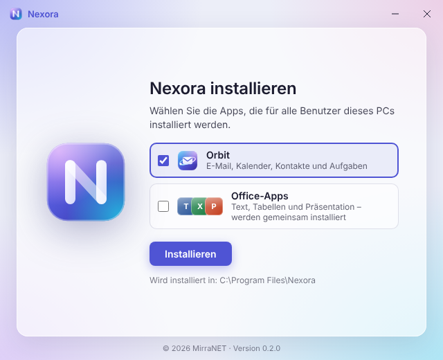

Every app runs as its own program – Ondura Mail, Text, Sheets and the others show up separately in the Task Manager and keep running when you close another one – and they still work together as a suite: shared accounts, opening documents and mail across apps. On Windows, the setup asks which apps to install: **Ondura Mail** on its own, the **office apps** (Text, Sheets, Slides, PDF, Notes, Planner, Diagrams, Forms), or both. Ondura is installed for all users of the PC and keeps itself up to date: new versions are downloaded in the background, and a *Restart* button in the title bar installs them – no setup window, no administrator prompt. This works the same way with the Linux packages.

On macOS, open the `.dmg` and drag Ondura into *Applications*. Ondura opens with its start page; Mail, Text, Sheets and Slides are in the *File* menu and on the start page, and documents open in the right app from Finder. Updates install the same way after a restart; if Ondura is in a folder you can't write to, macOS asks for an administrator password once.

> [!NOTE]
> **Warning on the first installation.** Ondura is not (yet) signed with a paid certificate from Microsoft or Apple, so the system warns about the unknown publisher the first time. This happens only once; updates install without it.
>
> - **Windows (SmartScreen):** "Windows protected your PC" – click **More info**, then **Run anyway**.
> - **macOS (Gatekeeper):** "Apple could not verify 'Ondura' …" – click **Done**, open *System Settings › Privacy & Security*, scroll down to *Security* and click **Open Anyway** next to Ondura, then confirm with your password. On macOS 14 and older, right-clicking Ondura in *Applications* and choosing **Open** also works. If macOS says Ondura is "damaged", run `xattr -dr com.apple.quarantine /Applications/Ondura.app` in Terminal.

**Languages:** Ondura speaks **German, English and French**. It starts in the language of your system; change it under *Help › Language*.

The source code is public, but you don't need it to use Ondura – just install it.

## The apps

| App | What it does |
| --- | --- |
| **Ondura Mail** | E-mail, calendar, contacts and tasks in one window, like Outlook |
| **Ondura Text** | Word processor for `.docx` and `.odt` |
| **Ondura Sheets** | Spreadsheets for `.xlsx` and `.ods` |
| **Ondura Slides** | Presentations for `.pptx` and `.odp` |
| **Ondura PDF** | View, comment on, edit, organise, protect, sign, compare and convert PDF files, with text recognition (OCR) |
| **Ondura Notes** | Notebooks with sections and pages like OneNote – on your computer or in OneNote |
| **Ondura Planner** | Plans with buckets and task cards like Microsoft Planner – on your computer or in Microsoft Planner |
| **Ondura Diagrams** | Flowcharts, org charts and network plans like Visio; saved as `.drawio` |
| **Ondura Forms** | Surveys, registrations and polls like Microsoft Forms, with charts of the responses – no server needed |

The user interface is available in German, English and French.

### Ondura Mail

| Calendar | Contacts | Tasks |
| --- | --- | --- |
|  | 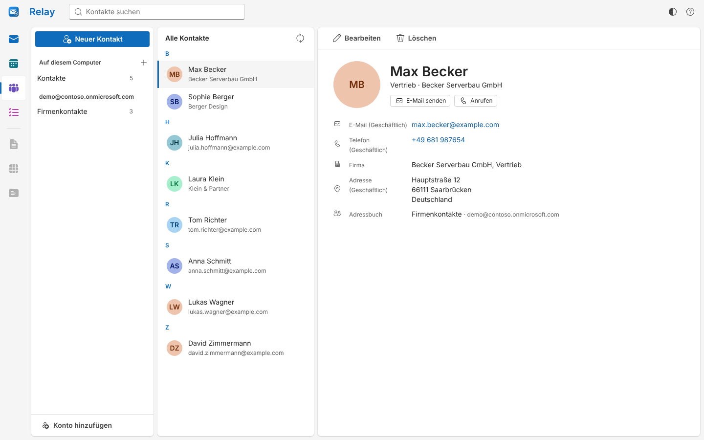 |  |

**E-mail**
- All accounts in one window, with folders, conversation view and fast full-text search (also on the server).
- **Work with windows**: double-click a message (or *Open in new window*) to open it in its own window, with its own toolbar for replying, forwarding, deleting and printing – as many as you like, side by side.
- Works offline: everything you do is applied at once and sent to the server as soon as it is reachable. Messages that could not be sent wait in the outbox.
- New mail arrives within seconds and shows a desktop notification; Ondura Mail can keep running in the tray.
- Rules, categories, flags, signatures, delayed sending, drafts and attachments (very large files on Microsoft 365 are shared via OneDrive, like in Outlook).
- **Focused inbox**, pinned messages, **snooze**, ignore conversation, **sweep**, block sender and **quick steps**.
- Importance, read and delivery receipts, **@mentions**, voting buttons and sending as a shared mailbox; the **global address list** suggests colleagues while you type. Mailbox quota and the online archive (Exchange) are shown in the folder pane; *Print* prints a message.
- **Automatic replies** (out of office) for Microsoft 365, Exchange and IMAP servers with Sieve – they are stored on the server and work while your PC is off.
- **Shared mailboxes** of Microsoft 365 and Exchange, shown as their own account.
- **S/MIME**: sign and encrypt messages with your certificate, check signatures and read encrypted mail.
- Privacy: HTML mail never runs scripts, and remote images (tracking pixels) are blocked until you allow them.

**Calendar** – day, work week, week and month views; recurring events; reminders; meeting invitations (send, accept, decline, **propose a new time**); scheduling assistant with free/busy times; room finder; drag & drop; **Teams meetings**; **shared calendars** and permissions (Microsoft 365); a second time zone; categories; public holidays; the weather; scheduling polls; export as `.ics`.

**Contacts** – address books with groups and photos, vCard import and export, address completion while writing, **merge duplicates** and the **organization chart** (Microsoft 365).

**Tasks** – task lists in the style of Microsoft To Do, with subtasks, due dates, recurring tasks and reminders, **My Day**, flagged e-mail as tasks and **Planner** plans with assignees (Microsoft 365).

| Signed mail | Message in its own window | Dark mode |
| --- | --- | --- |
| 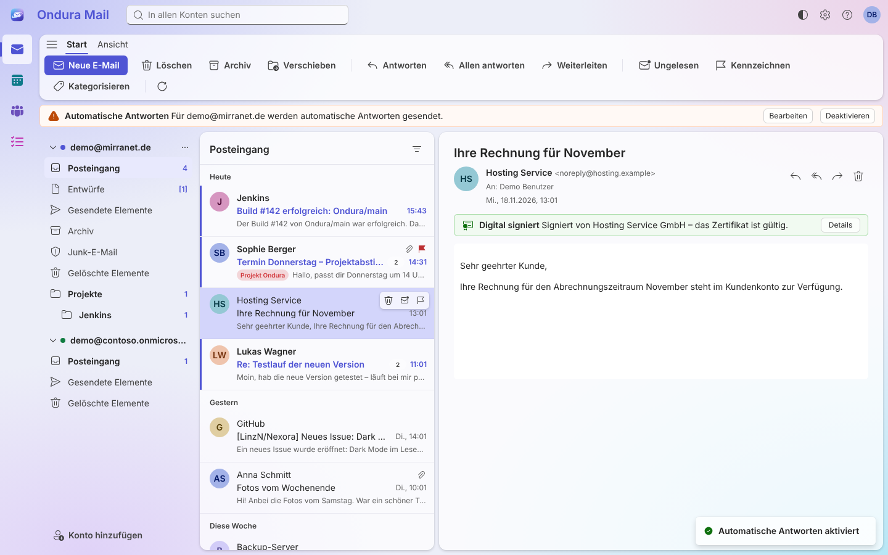 | 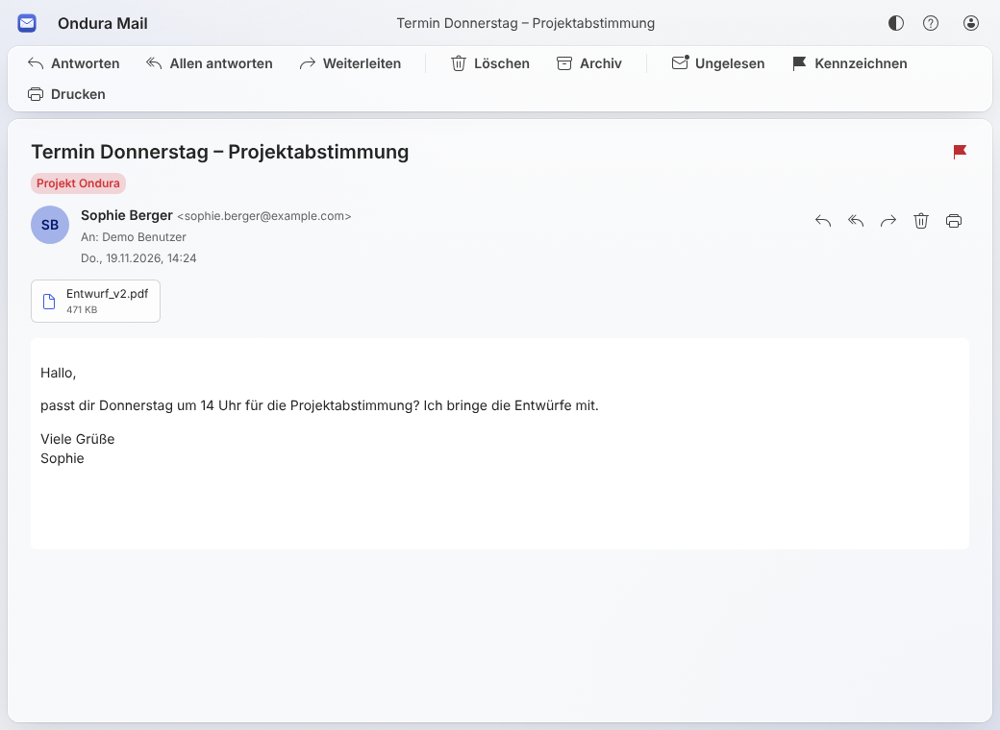 | 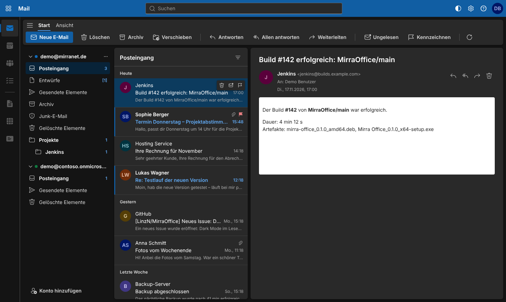 |

### Office apps

| Text | Sheets | Slides |
| --- | --- | --- |
|  | 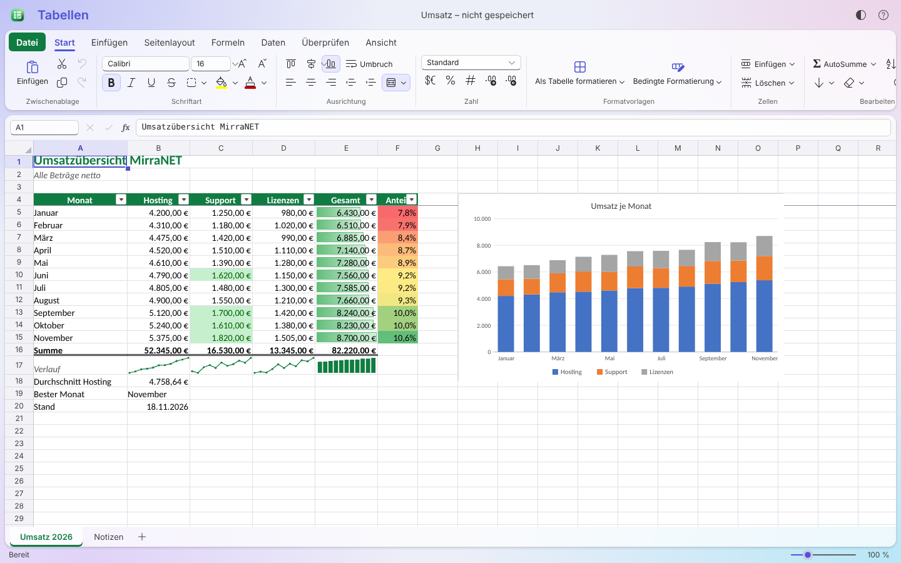 |  |

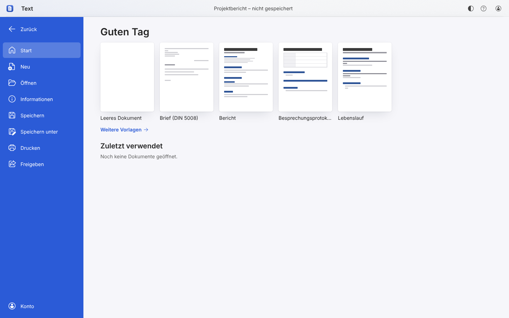

**Ondura Text** – page view like Word, styles, headers and footers, sections with different page layouts, columns, tables, images, shapes and text boxes, equations, drop caps, watermarks, page colour and borders, comments, tracked changes, **compare documents**, restrict editing, footnotes and endnotes, table of contents, captions and cross-references, citations and bibliography, index, mail merge, envelopes and labels, content controls (forms), templates (`.dotx`), outline view and reading mode, spell checking for German, English and French, grammar check (LanguageTool), translation, read aloud and dictation.

**Ondura Sheets** – about 500 functions including dynamic arrays, LAMBDA, GROUPBY/PIVOTBY, financial, statistical, engineering and complex-number functions; Excel tables, charts (also treemap, sunburst, box & whisker, waterfall, histogram, funnel), pivot tables and **PivotCharts**, **slicers and timelines**, sparklines, conditional formatting, data validation, filters, **Get & Transform Data** (CSV, JSON, web, other workbooks; refreshable), consolidate, what-if analysis and solver, shapes, in-cell checkboxes, threaded comments and notes, sheet views, grouped sheets, find & replace, hyperlinks, sheet protection, page layout and printing.

**Ondura Slides** – slide master, **Designer**, sections, tables, charts, editable SmartArt, pictures, **icons**, audio and video, freehand drawing, animations and motion paths, transitions including Morph, slide zoom and links, comments, presenter view, pen and laser pointer, **live captions**, **Presenter Coach**, rehearsed timings, recorded narration, handouts and notes pages, export as video.

**In the office apps**
- A **start page** like in Office: when an app opens without a file, it greets you with templates (letter, report, CV; budget, task list, invoice; one per design in Slides) and your recent files. *Ctrl+N* opens an empty document directly.
- **OneDrive and SharePoint**: open and save documents directly in the cloud, with a personal Microsoft account as well as a work or school account (*File › Account*). Documents in OneDrive are saved automatically while you work (*Automatisch speichern*), and *Datei › Freigeben* creates a link to share them. *File › Info* shows the **version history** (open or restore an earlier version), and the title bar tells you when someone else saved the document.
- **Search the commands** (*Was möchten Sie tun?*, Alt+Q) and the **quick access toolbar** (right-click any ribbon button). **AutoRecover** brings back unsaved work after a crash, and documents can be **protected with a password**.
- Files are opened and saved in their own format – no conversion. Anything a file contains that Ondura can't show is listed under *File › Info*.
- Export to PDF (*File › Export as PDF*) and **printing with Ondura's own print view** (*File › Print*, Ctrl+P): printer, copies, pages, duplex, colour and pages per sheet next to a preview of the real print-out – no browser dialog, no date or URL in the margins.
- **Accessibility checker** (*Review › Check accessibility*): finds missing alternative texts and slide titles, tables without header rows, skipped heading levels and text that is hard to read, and fixes many of them with one click.
- **Macros** (*View › Macros* in Sheets, *Developer › Macros* in Text): automate recurring work with small scripts; Sheets can record them for you. Macros are never stored in documents, so opening a file can't run code.

| Accessibility checker | Macros |
| --- | --- |
|  |  |

### Ondura PDF

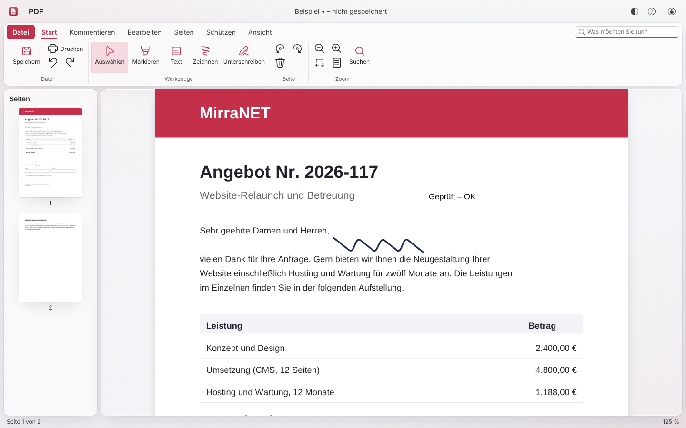

- **View** with page thumbnails, search, zoom, single or two-page layout and printing; links and form fields work.
- **Comment and edit**: highlight text, text boxes, freehand drawing, images; fill in **forms** and flatten them. Everything is saved as real PDF annotations, readable in any PDF reader.
- **Organise pages**: rotate, delete, duplicate, reorder by drag and drop, insert blank pages or other PDFs and images, extract pages, split a PDF into parts, merge PDFs, make a PDF from images.
- **Page numbers and watermarks**, white-out areas, and real **redaction**: redacted pages are rebuilt as images, so the text underneath is gone, not just hidden.
- **Sign**: a handwritten signature (drawn, typed or remembered on the device), and **digital signatures** with a certificate (.p12/.pfx, the same as for signed e-mail) – visible or invisible, added as an incremental update so earlier signatures stay valid. Signatures in opened files are checked and listed with their signer and status.
- **Password protection** (AES-256) with permissions for printing, copying and editing; protected PDFs open after asking for the password.
- **Edit text** in place: click a line, type the new text; it is written in the closest standard font and colour.
- **Recognise text (OCR)** in scanned PDFs: the recognised words are placed invisibly over the scan, so the PDF can be searched and copied. Runs offline with German and English built in.
- **Convert to Word**: an editable `.docx` with paragraphs, headings, lists, tables and pictures, opened in Ondura Text.
- **Compare files**: both versions side by side with every removed, added and changed word marked, a list of all changes and pages whose graphics changed.

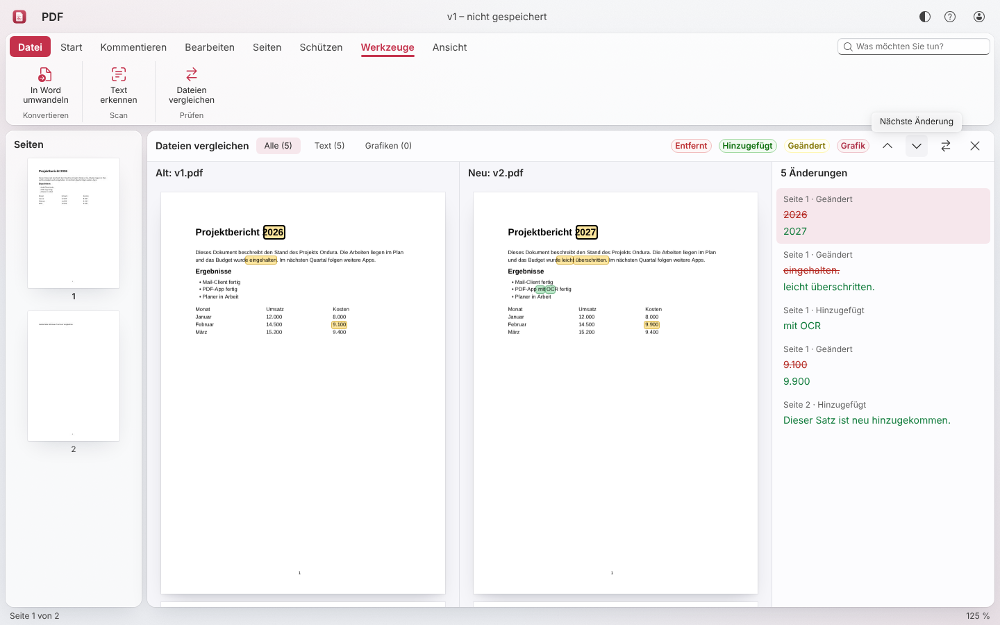

### Ondura Notes

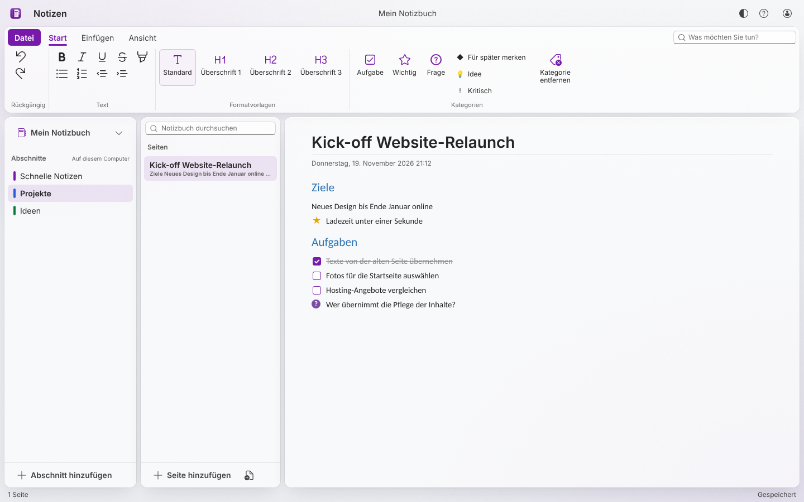

- Notebooks with sections, pages and subpages; headings, lists, tables, pictures and links; **tags** like in OneNote (to-dos you can tick off, important, question, idea …) and search across the notebook.
- Notebooks are kept **on your computer** or in **OneNote**: every Microsoft account in Ondura (Ondura Mail or *File › Account*) lists its OneNote notebooks, sections and section groups. Changes are written back to OneNote block by block, so the rest of the page stays as it is.

### Ondura Planner

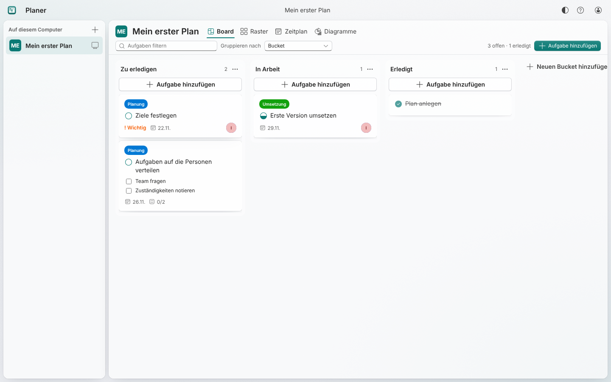

- Plans with **buckets** and **task cards**: labels, priority, progress, start and due dates, assignees, notes and checklists (optionally shown on the card).
- **Board** with drag and drop, grouped by bucket, progress, priority, due date, assignee or label; **grid**, monthly **schedule** and **charts**.
- Plans live **on your computer** or in **Microsoft Planner** (work or school accounts: the plans of your groups, with people search for assignments).

### Ondura Diagrams

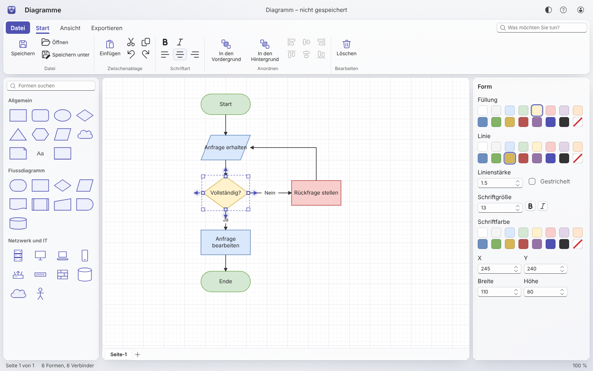

- Shapes for general use, **flowcharts** and **network and IT** plans; drag them onto the canvas, connect them by pulling the blue arrows – connectors follow their shapes (angled, straight or curved, with arrow heads and labels).
- Formatting, aligning and distributing, layers, copy and paste between windows, several pages, grid and snapping, templates (flowchart, org chart, network).
- Saved as **draw.io** files, so diagrams open in diagrams.net and draw.io files open in Ondura. Export as PDF, PNG and SVG.

### Ondura Forms

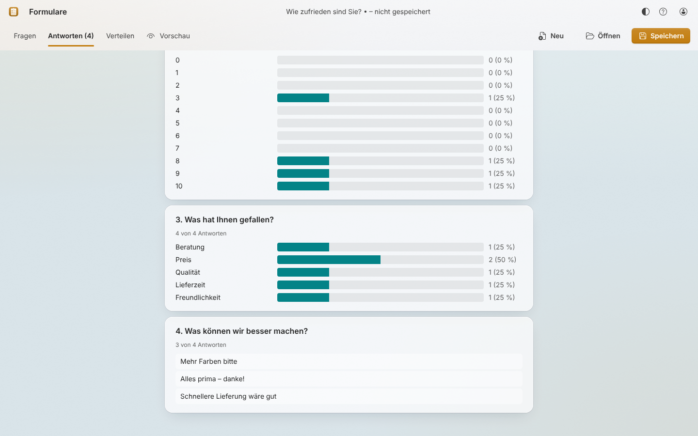

- Questions with choice, multiple choice, dropdown, text, number, date, **star rating** and **0–10 scale** (with net promoter score), sections, required answers, themes and templates.
- Collect answers **without a server**: fill in on this computer (kiosk mode), send a **fillable PDF form** and import the returned PDFs, or send a **web form** (one HTML file for any browser) whose answers come back by e-mail – Ondura picks them up from your mailbox.
- Responses as **charts per question**, one by one, and as an **Excel** or CSV table.

## Getting started

1. Open **Ondura Mail**, choose *Add account* and enter your e-mail address. Like Outlook, Ondura finds the right settings itself – from your provider, the Thunderbird database of mail providers or your domain's DNS records, otherwise by trying the usual server names – and checks the servers before it fills them in. Addresses hosted at Microsoft 365 or on an Exchange server are recognised, and Ondura switches to the matching account type.
2. Or pick the account type yourself:
   - **Microsoft 365 / Outlook.com** – sign in with Microsoft in your browser. For Outlook.com, Hotmail or Live accounts tick *Personal Microsoft account*.
   - **Exchange Server** (on-premises) – e-mail address, password and the EWS address of your server (Ondura suggests `https://mail.<your domain>/EWS/Exchange.asmx`).
   - **IMAP** (any other provider, e.g. GMX, Web.de, Gmail or your own server) – usually only the password is left to enter; otherwise the server names from your provider.
   - **CalDAV / CardDAV** (Nextcloud, Radicale, mailbox.org, iCloud, …) – for calendars, contacts and tasks; the server address is enough.
3. Mail, calendars, contacts and tasks of the account appear automatically. Calendars, contacts and tasks also work without any account, on your computer only.

If your company's IT has to approve Ondura first, Microsoft shows a message during sign-in. Point them to the [admin guide](docs/admin.md).

**Using OneDrive:** in Text, Sheets or Slides open *File › Account › Add account* and sign in with your Microsoft account. OneDrive (and for work accounts your SharePoint sites) then appears under *Open* and *Save as*. Microsoft 365 accounts added in Ondura Mail show their OneDrive there automatically.

**Using S/MIME:** import your certificate (`.p12`/`.pfx`) under *Settings › S/MIME*. New messages are then signed, and *Encrypt* in the message window encrypts them. Ondura learns the certificates of other people from signed messages they send you.

**Automatic replies:** *View › Automatic replies*. While they are on, a bar above the message list reminds you.

## Supported accounts

| Account | E-mail | Calendar | Contacts | Tasks |
| --- | --- | --- | --- | --- |
| Microsoft 365, Exchange Online, Outlook.com | ✅ | ✅ | ✅ | ✅ Microsoft To Do |
| Exchange Server 2013 SP1 and newer | ✅ | ✅ | ✅ | – |
| IMAP / SMTP (any provider) | ✅ | – | – | – |
| CalDAV / CardDAV | – | ✅ | ✅ | ✅ |
| On this computer | – | ✅ | ✅ | ✅ |

Documents: OneDrive (personal), OneDrive for Business and SharePoint (work or school accounts), and files on your computer. Notes: OneNote (personal and work or school accounts). Planner: Microsoft Planner (work or school accounts). Both also work without an account, on your computer.

## Your data

Ondura keeps a copy of your mail, calendars and contacts on your computer so it is fast and works offline. Passwords and sign-ins are stored in the credential store of your system (Windows Credential Manager, the macOS keychain, or GNOME Keyring / KWallet on Linux), never in plain files. Ondura doesn't send data anywhere except to your own mail, calendar and cloud storage services, and checks GitHub for updates.

## More information

- [ondura.mirranet.de](https://ondura.mirranet.de) – the Ondura website.
- [Admin guide](docs/admin.md) – rollout in companies, Microsoft 365 approval, silent installation, network requirements, data locations.
- [Developer guide](docs/development.md) – architecture, building from source, tests and releases.
- [Issues](https://github.com/Ondura-Suite/Ondura-Core/issues) – report bugs or suggest features.

## License

Copyright © 2026 Niklas Linz (MirraNET)

Ondura is free software: you can redistribute it and/or modify it under the terms of the [GNU General Public License](LICENSE) as published by the Free Software Foundation, either version 3 of the License, or (at your option) any later version. Ondura is distributed in the hope that it will be useful, but **without any warranty**; without even the implied warranty of merchantability or fitness for a particular purpose.

Ondura includes open-source components under their own licenses (MIT, Apache-2.0, BSD, MPL-2.0 and others; the German spell-check dictionary igerman98 under GPL-2.0/GPL-3.0). Their notices are listed in [THIRD-PARTY-NOTICES.txt](THIRD-PARTY-NOTICES.txt) and in the app under *Hilfe › Über Ondura*.

Contributions are accepted under the same license (GPL-3.0-or-later).

### Trademarks

The name "Ondura" and the Ondura logo are not covered by the license. Modified versions you distribute must use a different name and logo. Microsoft, Microsoft 365, Outlook, Exchange, OneDrive and SharePoint are trademarks of the Microsoft group of companies. Ondura is an independent product and is not affiliated with, endorsed or sponsored by Microsoft.
