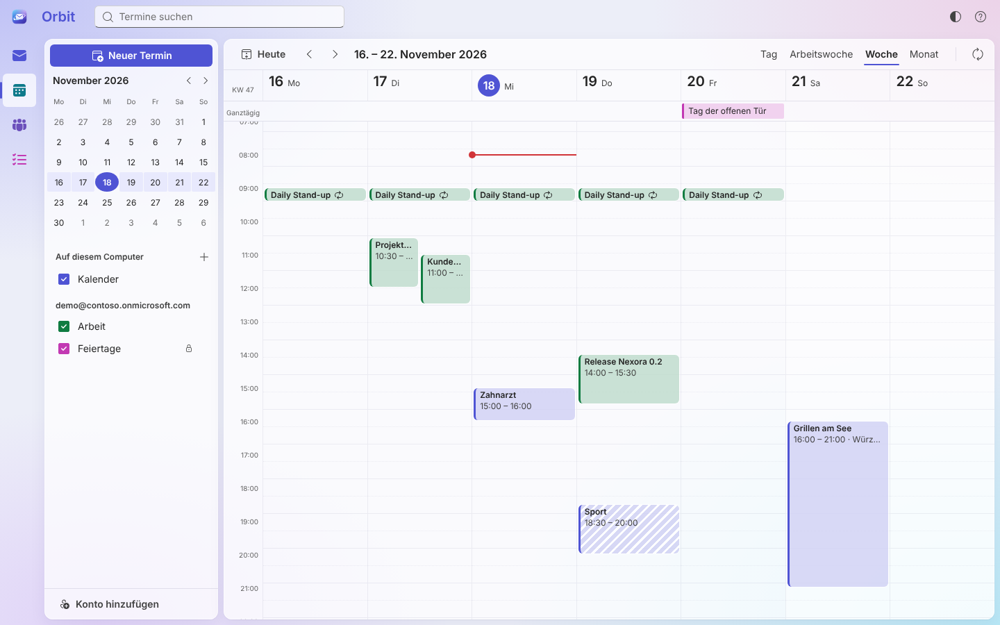
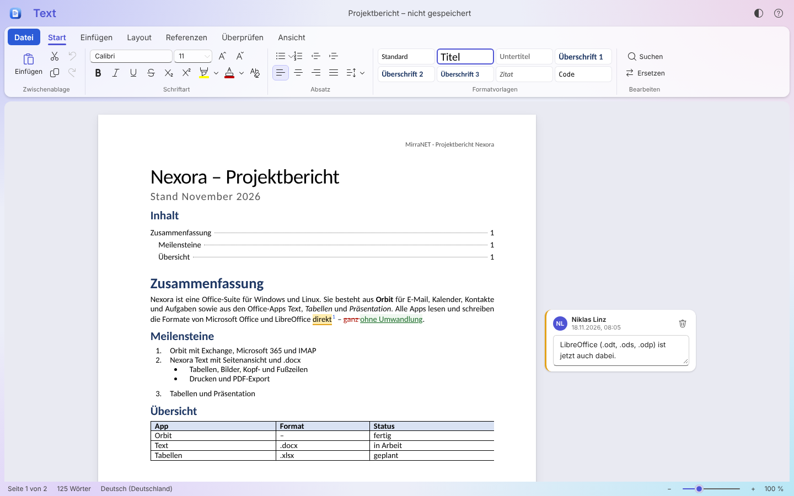

  

<h1 align="center">Ondura</h1>

<b>Mail · Text · Tabellen · Präsentation</b> – the office suite for Windows and Linux

**Ondura** is an office suite for **Windows and Linux**: e-mail with calendar, contacts and tasks, a word processor, spreadsheets and presentations. It looks and works like Microsoft 365, opens and saves Microsoft Office and LibreOffice files directly, and works with Microsoft 365, Exchange and any IMAP mail server.

## Download

Get the latest version from the [releases page](https://github.com/Ondura-Suite/Ondura-Core/releases):

| System | File |
| --- | --- |
| Windows 10/11 (64-bit) | `Ondura_<version>_x64_Setup.exe` |
| Debian, Ubuntu, Linux Mint | `.deb` |
| Fedora, openSUSE, RHEL | `.rpm` |
| Other Linux distributions | `.AppImage` |

On Windows, the setup asks which apps to install: **Ondura Mail** on its own, the **office apps** (Text, Tabellen, Präsentation), or both. Ondura is installed for all users of the PC and keeps itself up to date: new versions are downloaded in the background, and a *Neu starten* button in the title bar installs them – no setup window, no administrator prompt. This works the same way with the Linux packages.

The source code is public, but you don't need it to use Ondura – just install it.

## The apps

| App | What it does |
| --- | --- |
| **Ondura Mail** | E-mail, calendar, contacts and tasks in one window, like Outlook |
| **Ondura Text** | Word processor for `.docx` and `.odt` |
| **Ondura Tabellen** | Spreadsheets for `.xlsx` and `.ods` |
| **Ondura Präsentation** | Presentations for `.pptx` and `.odp` |

The user interface is in German.

### Ondura Mail

| Kalender | Kontakte | Aufgaben |
| --- | --- | --- |
|  |  |  |

**E-mail**
- All accounts in one window, with folders, conversation view and fast full-text search (also on the server).
- Works offline: everything you do is applied at once and sent to the server as soon as it is reachable. Messages that could not be sent wait in the outbox.
- New mail arrives within seconds and shows a desktop notification; Ondura can keep running in the tray.
- Rules, categories, flags, signatures, delayed sending, drafts and attachments (very large files on Microsoft 365 are shared via OneDrive, like in Outlook).
- **Automatic replies** (out of office) for Microsoft 365, Exchange and IMAP servers with Sieve – they are stored on the server and work while your PC is off.
- **Shared mailboxes** of Microsoft 365 and Exchange, shown as their own account.
- **S/MIME**: sign and encrypt messages with your certificate, check signatures and read encrypted mail.
- Privacy: HTML mail never runs scripts, and remote images (tracking pixels) are blocked until you allow them.

**Calendar** – day, work week, week and month views; recurring events; reminders; meeting invitations (send, accept, decline); scheduling assistant with free/busy times; room finder; drag & drop.

**Contacts** – address books with groups and photos, vCard import and export, address completion while writing.

**Tasks** – task lists in the style of Microsoft To Do, with subtasks, due dates, recurring tasks and reminders.

| Signed mail and automatic replies | Dark mode |
| --- | --- |
|  |  |

### Office apps

| Text | Tabellen | Präsentation |
| --- | --- | --- |
|  |  |  |

**Ondura Text** – page view like Word, styles, headers and footers, sections with different page layouts, tables, images, comments, tracked changes, footnotes and endnotes, table of contents, captions and cross-references, citations and bibliography, index, mail merge, content controls (forms), spell checking for German and English.

**Ondura Tabellen** – around 180 functions including dynamic arrays, Excel tables, charts, pivot tables, sparklines, conditional formatting, data validation, filters, what-if analysis and solver, notes, hyperlinks, sheet protection, page layout and printing.

**Ondura Präsentation** – slide master, tables, charts, editable SmartArt, pictures, audio and video, animations and motion paths, transitions including Morph, slide zoom and links, presenter view, pen and laser pointer, rehearsed timings, recorded narration and export as video.

**In all three apps**
- **OneDrive and SharePoint**: open and save documents directly in the cloud, with a personal Microsoft account as well as a work or school account (*Datei › Konto*). Documents in OneDrive are saved automatically while you work (*Automatisch speichern*), and *Datei › Freigeben* creates a link to share them.
- Files are opened and saved in their own format – no conversion. Anything a file contains that Ondura can't show is listed under *Datei › Informationen*.
- Export to PDF (*Datei › Als PDF exportieren*).
- **Accessibility checker** (*Überprüfen › Barrierefreiheit überprüfen*): finds missing alternative texts and slide titles, tables without header rows, skipped heading levels and text that is hard to read, and fixes many of them with one click.
- **Macros** (*Ansicht › Makros* in Tabellen, *Entwicklertools › Makros* in Text): automate recurring work with small scripts; Tabellen can record them for you. Macros are never stored in documents, so opening a file can't run code.

| Accessibility checker | Macros |
| --- | --- |
|  |  |

## Getting started

1. Open **Ondura Mail** and choose *Konto hinzufügen*.
2. Pick your account type:
   - **Microsoft 365 / Outlook.com** – sign in with Microsoft in your browser. For Outlook.com, Hotmail or Live accounts tick *Privates Microsoft-Konto*.
   - **Exchange Server** (on-premises) – e-mail address, password and the EWS address of your server (Ondura suggests `https://mail.<your domain>/EWS/Exchange.asmx`).
   - **IMAP** (any other provider, e.g. GMX, Web.de, Gmail or your own server) – e-mail address, password and the server names from your provider (Ondura suggests `mail.<your domain>`).
   - **CalDAV / CardDAV** (Nextcloud, Radicale, mailbox.org, iCloud, …) – for calendars, contacts and tasks; the server address is enough.
3. Mail, calendars, contacts and tasks of the account appear automatically. Calendars, contacts and tasks also work without any account, on your computer only.

If your company's IT has to approve Ondura first, Microsoft shows a message during sign-in. Point them to the [admin guide](docs/admin.md).

**Using OneDrive:** in Text, Tabellen or Präsentation open *Datei › Konto › Konto hinzufügen* and sign in with your Microsoft account. OneDrive (and for work accounts your SharePoint sites) then appears under *Öffnen* and *Speichern unter*. Microsoft 365 accounts added in Ondura Mail show their OneDrive there automatically.

**Using S/MIME:** import your certificate (`.p12`/`.pfx`) under *Einstellungen › S/MIME*. New messages are then signed, and *Verschlüsseln* in the message window encrypts them. Ondura learns the certificates of other people from signed messages they send you.

**Automatic replies:** *Ansicht › Automatische Antworten*. While they are on, a bar above the message list reminds you.

## Supported accounts

| Account | E-mail | Calendar | Contacts | Tasks |
| --- | --- | --- | --- | --- |
| Microsoft 365, Exchange Online, Outlook.com | ✅ | ✅ | ✅ | ✅ Microsoft To Do |
| Exchange Server 2013 SP1 and newer | ✅ | ✅ | ✅ | – |
| IMAP / SMTP (any provider) | ✅ | – | – | – |
| CalDAV / CardDAV | – | ✅ | ✅ | ✅ |
| On this computer | – | ✅ | ✅ | ✅ |

Documents: OneDrive (personal), OneDrive for Business and SharePoint (work or school accounts), and files on your computer.

## Your data

Ondura keeps a copy of your mail, calendars and contacts on your computer so it is fast and works offline. Passwords and sign-ins are stored in the credential store of your system (Windows Credential Manager, or GNOME Keyring / KWallet on Linux), never in plain files. Ondura doesn't send data anywhere except to your own mail, calendar and cloud storage services, and checks GitHub for updates.

## More information

- [Admin guide](docs/admin.md) – rollout in companies, Microsoft 365 approval, silent installation, network requirements, data locations.
- [Developer guide](docs/development.md) – architecture, building from source, tests and releases.
- [Issues](https://github.com/Ondura-Suite/Ondura-Core/issues) – report bugs or suggest features.

## Third-party data

The spell checker uses the Hunspell dictionaries from the npm packages `dictionary-de` (igerman98, GPL-2.0 or GPL-3.0) and `dictionary-en` (MIT and BSD). They are shipped as separate files next to the app and loaded at runtime.
